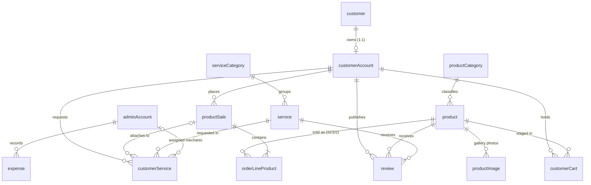

# PedalWorks Dynamics: Bicycle Shop Management System

[](https://www.php.net/)
[](https://www.mysql.com/)
[](https://getbootstrap.com/)
[](https://www.apachefriends.org/)
[](https://www.tup.edu.ph/)
[-10b981?style=flat-square)](https://github.com/Abenad1123/PedalWorks-Dynamics)

An enterprise-grade, integrated e-commerce, inventory, service booking, and business operations management platform engineered for modern bicycle retail and repair shops. Developed for the Information Management curriculum (**BSIT-2B-T**) at the **Technological University of the Philippines – Taguig**.

---

## Table of Contents
- [Project Overview](#project-overview)
- [Requirements Compliance Matrix](#requirements-compliance-matrix)
- [Key Features](#key-features)
  - [Customer Storefront & Self-Service](#customer-storefront--self-service)
  - [Administrative Management Console](#administrative-management-console)
  - [Role-Based Access Control (RBAC)](#role-based-access-control-rbac)
  - [Data Integrity & SCD Type 2 Temporal Pricing](#data-integrity--scd-type-2-temporal-pricing)
  - [ACID Checkout & Stock Reservation](#acid-checkout--stock-reservation)
  - [Automated Email Receipts (Mailtrap & FPDF)](#automated-email-receipts-mailtrap--fpdf)
- [Design System (Hallmark & Apple HIG)](#design-system-hallmark--apple-hig)
- [System Architecture & Tech Stack](#system-architecture--tech-stack)
- [Directory Structure](#directory-structure)
- [Database Schema & ERD](#database-schema--erd)
- [Installation & Setup](#installation--setup)
- [Default Seed Accounts](#default-seed-accounts)
- [Security & Design Considerations](#security--design-considerations)
- [Technical Manual & Architecture PDF](#technical-manual--architecture-pdf)
- [Academic Credits](#academic-credits)

---

## Project Overview

**PedalWorks Dynamics** is an adventure bike shop and technical workshop operating in Taguig City (Km. 14 East Service Road, Western Bicutan). The application unifies commercial bike retailing, multi-photo gear showcases, cart processing, verified customer reviews with profanity filtering, workshop labor booking, inventory auditing, staff RBAC, and automated financial accounting.

Key architectural highlights:
1. **Public Storefront**: Responsive browsing for gravel bikes, MTBs, frames, parts, and safety gear, with homepage instant search and live stock badges.
2. **Unified Workshop Lab**: Standalone service appointment bookings or seamless order-attached assembly/installation labor.
3. **ACID Transaction Integrity**: Concurrency-safe checkout with pessimistic row locks preventing overselling or negative inventory balances.
4. **Historical Price Integrity**: Implementation of Slowly Changing Dimensions (SCD Type 2) guaranteeing that price changes never corrupt past invoices or ledger reports.
5. **Automated Order Dispatch**: PHPMailer + Mailtrap SMTP integration automatically generating and emailing itemized PDF receipts upon order fulfillment.

---

## Requirements Compliance Matrix

The system satisfies 100% of the course functional requirements and grading rubrics:

### 1. Proposal Functional Requirements (FR1 – FR20)
| Module / Section | Requirements | Status | Primary Code Location |
| :--- | :--- | :---: | :--- |
| **I. User & Authentication** | **FR1** (Customer Registration/Login), **FR2** (Admin RBAC Gate) | `100% Completed` | `signup.php`, `login.php`, `includes/admin_auth.php` |
| **II. Catalog & Services** | **FR3** (Categorized Browsing), **FR4** (Search/Filter), **FR5** (Service Listing) | `100% Completed` | `products.php`, `index.php`, `services.php` |
| **III. Cart & Orders** | **FR6** (Add to Cart), **FR7** (Cart Editing), **FR8** (Checkout/COD/Pickup), **FR9** (Order History) | `100% Completed` | `cart.php`, `checkout.php`, `user/orders.php` |
| **IV. Inventory Control** | **FR10** (Add Products), **FR11** (Edit/Pricing/Photos), **FR12** (Auto Stock Deduction), **FR13** (Low Stock Alert), **FR14** (Product Archiving) | `100% Completed` | `admin/product/`, `admin/dashboard.php`, `checkout.php` |
| **V. Workshop Repairs** | **FR15** (Repair Scheduling & Order Attachment), **FR16** (Service Status Lifecycle) | `100% Completed` | `services.php`, `admin/service_requests/`, `user/services.php` |
| **VI. Financial Auditing** | **FR17** (Expense Input), **FR18** (Derived Sales Income), **FR19** (Income vs. Expense P&L), **FR20** (Printable Reports) | `100% Completed` | `admin/expenses/`, `admin/reports/` |

### 2. Machine Problems & Lab Exam (`ITIM211-Proj.txt`)
| Grading Component | Points | Status | Features & Verification |
| :--- | :---: | :---: | :--- |
| **MP1: Product/Service CRUD** | **20 / 20** | `Completed` | Full CRUD, single photo upload, multiple gallery photos (`productImage`), primary photo selection. |
| **MP2: User CRUD** | **20 / 20** | `Completed` | Registration photo upload, profile photo editing, user account deactivation (`Disabled`), admin role assignment. |
| **MP3: Login & Access Control** | **20 / 20** | `Completed` | Email-based login, strict ordinary-user restriction from CRUD routes, flash message redirects, staff RBAC. |
| **MP4: Review CRUD & Regex Filter** | **20 / 20** | `Completed` | Verified purchaser/client review validation, display on product details, update/delete review, regex profanity masking (`maskProfanity()`). |
| **MP5: Server-Side Form Validation** | **20 / 20** | `Completed` | Pure PHP server-side validation on login and product CRUD with explicit `novalidate` forms (no HTML5 validation reliance). |
| **Term Test Lab Exam** | **35 / 35** | `Completed` | Prepared statements, admin status updates, Mailtrap SMTP dispatch, itemized email breakdown, attached FPDF receipt. |
| **Unit 1: Database Design** | **20 / 20** | `Completed` | 3NF relational normalization + SCD Type 2 temporal versioning; MySQL Views (`vw_order_summary`, `vw_order_transaction_details`). |
| **Unit 2: Execution & UI** | **20 / 20** | `Completed` | Zero PHP runtime errors; Hallmark 8-State Interactive Discipline and Apple HIG squircle craft. |
| **Quiz 3: Homepage Search** | **15 / 15** | `Completed` | Dedicated catalog search input integrated into the homepage hero section. |

---

## Key Features

### Customer Storefront & Self-Service
- **Homepage & Instant Search (`index.php`)**: Hero search directly routing queries to the catalog, elevation tracker, and trail pillars.
- **Dynamic Catalog (`products.php`)**: Multi-criteria keyword, SKU, and category filtering across bicycles, parts, attachments, and safety gear.
- **Product Showcase & Gallery (`product_details.php`)**: Multiple gallery photos, stock indicators, tabular technical specifications, and verified customer reviews.
- **Interactive Review System (`review_action.php`)**: Exclusive to customers who purchased the item or availed the service; uses regex to mask offensive terms.
- **Workshop Booking Directory (`services.php`)**: Standalone repair appointments with mechanic notes, scheduling, and verified service reviews.
- **Interactive Cart & Stepper (`cart.php`)**: Apple HIG touch-friendly quantity steppers with live subtotal recalculation and inventory guards.
- **Fulfillment & Checkout (`checkout.php`)**: Supports Metro Manila Doorstep COD Delivery or Free Taguig Basecamp Pickup, with optional bundled labor/parts installation.
- **Customer Portal (`user/orders.php`, `user/services.php`, `user/profile.php`)**: Track past order statuses, view workshop progress, and update profile credentials/photos.

### Administrative Management Console
- **Central Dashboard (`admin/dashboard.php`)**: Operational KPI cards (Products, Services, Customers, Staff, Pending Repairs, Monthly Expenses, Order Stats) and automatic low-stock warnings.
- **Customer Orders & Transactions (`admin/orders/`)**: Order fulfillment workflow, status pipeline (`Pending` $\rightarrow$ `Received` $\rightarrow$ `In Progress` $\rightarrow$ `Ready for Pickup` $\rightarrow$ `Completed`), automated Mailtrap notification emails, and downloadable FPDF receipts.
- **Inventory & Multiple Photos (`admin/product/`)**: Full product CRUD, multi-image gallery manager, low-stock threshold triggers, restock/dispatch stock tools, and safe archiving.
- **Workshop Service Requests (`admin/service_requests/`)**: Schedule repair requests, assign certified technicians (`adminAccountID`), and monitor workshop throughput.
- **Operational Overhead Expenses (`admin/expenses/`)**: Record shop bills (Water, Electricity, Salary, Rent, Other) with check constraint descriptions.
- **Financial & Inventory Reports (`admin/reports/`)**: Real-time sales vs. expense P&L generation and formatted printable web pages.

### Role-Based Access Control (RBAC)

The administrative suite enforces role authorization via [`includes/admin_auth.php`](includes/admin_auth.php):

| Role | Authorized Modules | Operational Scope |
| :--- | :--- | :--- |
| **Super Administrator** | **All Modules (Full Control)** | Staff account creation, role assignments, system-wide management. |
| **Inventory Manager** | **Products, Catalog & Orders** | Product CRUD, multi-photo gallery, stock adjustments, order fulfillment. |
| **Service & Repair Manager** | **Workshop Services & Requests** | Service package CRUD, mechanic job assignment, repair status tracking. |
| **Accounting Administrator** | **Orders, Customers, Expenses & Reports** | Order auditing, customer accounts, expense logging, P&L reporting. |

---

## Design System (Hallmark & Apple HIG)

The visual design system ([`includes/style/style.css`](includes/style/style.css)) incorporates the **Hallmark AI Design Discipline** and **Apple Human Interface Guidelines (HIG)**:
- **Obsidian Adventure Palette**: Obsidian Slate (`#090d12`), Pine Deep (`#131a22`), Moss Green (`#1d3d30`), and Trail Terracotta (`#e5793a`).
- **Hallmark 8-State Interactive Discipline**: Every button and form control explicitly styles `default`, `:hover`, `:focus-visible`, `:active`, `disabled`, `.is-loading`, `.is-invalid`, and `.is-valid`.
- **WCAG AA/AAA Contrast Compliance**: All text tokens on dark surfaces strictly exceed 5.1:1 (`--pw-text-faint: #94a3b8`) and 8.5:1 (`--pw-text-muted: #cbd5e1`).
- **Apple HIG Touch Targets & Squircle Radii**: Continuous squircle corners (`12px`, `14px`, `18px`, `980px`), specular top-edge lighting (`1px solid rgba(255, 255, 255, 0.18)`), and minimum $44 \times 44\,\text{px}$ touch targets on mobile.
- **Hallmark Table Craft (`.pw-table`)**: Letter-spaced uppercase column headers (`0.72rem`), tabular numerals (`font-variant-numeric: tabular-nums`), and smooth row hover highlights.

---

## System Architecture & Tech Stack

```
   ┌─────────────────────────────────────────────────────────┐
   │                     Client Browser                      │
   └───────────────┬─────────────────────────┬───────────────┘
                   │ Storefront Requests     │ Admin Requests
                   ▼                         ▼
   ┌─────────────────────────────┐  ┌─────────────────────────────┐
   │ Storefront (Public / User)  │  │ Admin Console (RBAC Guard)  │
   │  - index.php / products.php │  │  - admin/dashboard.php      │
   │  - services.php / cart.php  │  │  - admin/orders/index.php   │
   │  - user/orders.php          │  │  - includes/admin_auth.php  │
   └───────────────┬─────────────┘  └────────┬────────────────────┘
                   │                         │
                   ▼                         ▼
   ┌─────────────────────────────────────────────────────────┐
   │               PHP 8.2+ Backend Framework                │
   │  - Database Connection (includes/config.php)            │
   │  - Session Auth & Password Hashing (Bcrypt)             │
   │  - ACID Transactions (mysqli_begin_transaction)         │
   │  - Prepared Statements (Prepared MySQLi API)            │
   │  - Automated Emailer (PHPMailer & Mailtrap SMTP)        │
   │  - PDF Document Engine (FPDF 1.86)                      │
   └─────────────────────────────┬───────────────────────────┘
                                 │
                                 ▼
   ┌─────────────────────────────────────────────────────────┐
   │              MySQL Database (pedalworks_db)             │
   │  - InnoDB Storage Engine (Foreign Keys, Cascade Guards) │
   │  - Generated Virtual Columns (isCurrent via IF/STORED)  │
   │  - Slowly Changing Dimensions Type 2 (SCD2 Price Audit) │
   │  - Pre-Aggregated Views (vw_order_summary, details)     │
   └─────────────────────────────────────────────────────────┘
```

---

## Directory Structure

```plaintext
PedalWorks-Dynamics/
│
├── admin/                         # Administrative Back-Office Console
│   ├── dashboard.php              # Central Management Dashboard & KPIs
│   ├── adminAccount/              # Staff Administrator CRUD & Roles
│   ├── customerAccount/           # Customer Management & Account Status
│   ├── expenses/                  # Shop Overhead Expense Logging
│   ├── orders/                    # Order Fulfillment, Mailtrap & FPDF Receipts
│   ├── product/                   # Product CRUD, Multi-Photos & Stock Tools
│   ├── reports/                   # Financial Reports & Printable Views
│   ├── service/                   # Workshop Service Package CRUD
│   └── service_requests/          # Repair Job Scheduling & Mechanic Assignment
│
├── assets/                        # Static Assets
│   ├── images/                    # Catalog Images & Hero Banner
│   └── uploads/                   # User Profile Photos & Multi-Photo Gallery
│
├── includes/                      # Reusable System Libraries & Partials
│   ├── admin_auth.php             # RBAC Verification & Route Guards
│   ├── admin_nav.php              # Dynamic Role-Filtered Admin Top Navigation
│   ├── config.php                 # Database Connection & Environment Config
│   ├── footer.php                 # Storefront Footer
│   ├── fpdf/                      # FPDF 1.86 PDF Generation Library
│   ├── header.php                 # Storefront Glass Navigation Bar
│   ├── PHPMailer/                 # PHPMailer SMTP Library
│   ├── profanity_filter.php       # Regex Word Masking Utility
│   └── style/
│       └── style.css              # Hallmark & Apple HIG Design System Stylesheet
│
├── user/                          # Customer Self-Service Portal
│   ├── orders.php                 # Customer Order History & Tracking
│   ├── profile.php                # Customer Profile & Photo Updates
│   ├── services.php               # Workshop Repair Request Status Tracker
│   └── cancel_service_action.php  # Service Cancellation Handler
│
├── cart.php                       # Shopping Cart & Quantity Steppers
├── cart_action.php                # Cart Mutation Handler
├── checkout.php                   # ACID Transactional Checkout Pipeline
├── db.sql                         # Authoritative 3NF + SCD2 MySQL Schema
├── generate_system_docs_pdf.php   # Automated Technical Architecture PDF Generator
├── index.php                      # Public Storefront & Homepage Search
├── login.php                      # Dual Customer/Admin Login Gate (Email/Username)
├── logout.php                     # Session Termination
├── products.php                   # Public Product Catalog & Dynamic Filtering
├── product_details.php            # Product Showcase, Gallery & Review Form
├── review_action.php              # Verified Customer Review CRUD Handler
├── seed_admin.php                 # Staff Seed Script
├── seed_catalog.php               # Catalog & Services Seed Script
├── services.php                   # Public Workshop Services Directory & Reviews
├── signup.php                     # Customer Registration with Photo Upload
├── PedalWorks_Dynamics_System_and_Database_Architecture.pdf # Technical Architecture PDF
└── README.md                      # Project Documentation
```

---

## Database Schema & ERD

The schema (`pedalworks_db`) consists of **13 relational tables** and **2 views**:



1. **`customer`**: Personal demographic profiles (Name, Email, Birthdate, Street Address).
2. **`customerAccount`**: Login credentials (`Active`, `Inactive`, `Disabled`).
3. **`adminAccount`**: Staff credentials assigned to explicit operational RBAC roles.
4. **`productCategory`**: Master categories (Full Build Bikes, Parts, Extra Attachments, Safety Gear).
5. **`serviceCategory`**: Workshop labor classifications (Overhauls, Repairs, Tuning).
6. **`product`**: Sellable inventory items with SKU, price, stock, alert limits, `startDate`, and `endDate` (SCD Type 2).
7. **`service`**: Workshop service offerings with labor pricing and SCD Type 2 date ranges.
8. **`productImage`**: Multi-photo gallery showcase items with primary flags.
9. **`customerCart`**: Customer active shopping cart lines with compound unique constraints.
10. **`productSale`**: Checkout sales orders recording fulfillment method, payment, and delivery address.
11. **`orderLineProduct`**: Immutable line items pointing to the specific product version active during checkout.
12. **`customerService`**: Bike repair service requests, scheduled dates, notes, and mechanic assignments.
13. **`expense`**: Overhead operational expenditures recorded by accounting personnel.
14. **`review`**: Verified customer ratings (1–5 stars) and masked review feedback.

---

## Installation & Setup

### Prerequisites
- [XAMPP](https://www.apachefriends.org/) with **Apache** and **MySQL** (PHP 8.2+ recommended).
- Web browser (Chrome, Edge, Firefox, Safari).

### Step-by-Step Installation

1. **Clone the Repository**
   Place the project inside your XAMPP web root (`C:/xampp/htdocs/project/`):
   ```bash
   git clone https://github.com/Abenad1123/PedalWorks-Dynamics.git
   ```

2. **Start Apache & MySQL**
   - Open the **XAMPP Control Panel**.
   - Start both **Apache** and **MySQL**.

3. **Import Database Schema**
   - Open [phpMyAdmin](http://localhost/phpmyadmin/).
   - Create a database named `pedalworks_db` with `utf8mb4_general_ci` collation.
   - Import the [`db.sql`](db.sql) file located in the project root.

4. **Seed Administrative Accounts & Catalog Data**
   Open PowerShell or Terminal in the project folder and run:
   ```bash
   # 1. Seed administrator role accounts
   php seed_admin.php

   # 2. Seed all 36 catalog products and workshop services
   php seed_catalog.php
   ```

5. **Launch the Application**
   - **Customer Storefront**: `http://localhost/project/PedalWorks-Dynamics/index.php`
   - **Login Portal**: `http://localhost/project/PedalWorks-Dynamics/login.php`
   - **Management Console**: `http://localhost/project/PedalWorks-Dynamics/admin/dashboard.php`

---

## Default Seed Accounts

*Note: For testing and academic demonstration only. Update passwords in production.*

| Module | Identifier / Username | Default Password | Assigned Role / Type | Primary Permissions |
| :--- | :--- | :--- | :--- | :--- |
| **Admin** | `admin` | `Admin123!` | Super Administrator | Full system control & user admin |
| **Admin** | `inventory_admin` | `Admin123!` | Inventory Manager | Product catalog, gallery & stock |
| **Admin** | `service_admin` | `Admin123!` | Service & Repair Manager | Workshop services & repair requests |
| **Admin** | `accounting_admin`| `Admin123!` | Accounting Administrator | Orders, expenses & P&L reports |
| **Store** | `jdelacruz` | `Customer123!` | Customer | Online shopping, checkout & reviews |

---

## Security & Design Considerations

- **SQL Injection Prevention**: All dynamic database operations execute through prepared statements with bound parameters (`mysqli_prepare`, `mysqli_stmt_bind_param`).
- **Cryptographic Password Security**: Passwords are never stored in plaintext; all credential verification uses standard `password_hash()` and `password_verify()` (Bcrypt).
- **Cross-Site Scripting (XSS) Mitigation**: User inputs are escaped before rendering via `htmlspecialchars($data, ENT_QUOTES, 'UTF-8')`.
- **Session & RBAC Guards**: Administrative routes validate active session states with `hasAdminRole()` and `requireAdminRole()`, rejecting unauthorized attempts.
- **Transactional Atomicity**: Checkout operations wrap stock reservation and order creation inside `mysqli_begin_transaction()` with automatic rollback on error.
- **Profanity Filtering**: Review submissions are screened using word-boundary regular expressions (`/\b...\b/i`) masking inappropriate English and Tagalog words.

---

## Technical Manual & Architecture PDF

For an in-depth exploration of the schema design, Slowly Changing Dimensions (Type 2), ACID transactions, and comprehensive oral defense questions and answers, refer to the generated technical manual:
- **PDF Document**: [PedalWorks_Dynamics_System_and_Database_Architecture.pdf](PedalWorks_Dynamics_System_and_Database_Architecture.pdf)
- **Regenerate via CLI**:
  ```bash
  php generate_system_docs_pdf.php
  ```

---

## Academic Credits

- **Course**: Information Management (ITIM211)
- **Degree & Section**: Bachelor of Science in Information Technology (BSIT-2B-T)
- **Institution**: Technological University of the Philippines – Taguig
- **Academic Year**: 2026–2027

---
Developed for **PedalWorks Dynamics** &bull; Engineering Adventure Bicycle Retail & Workshop Operations
